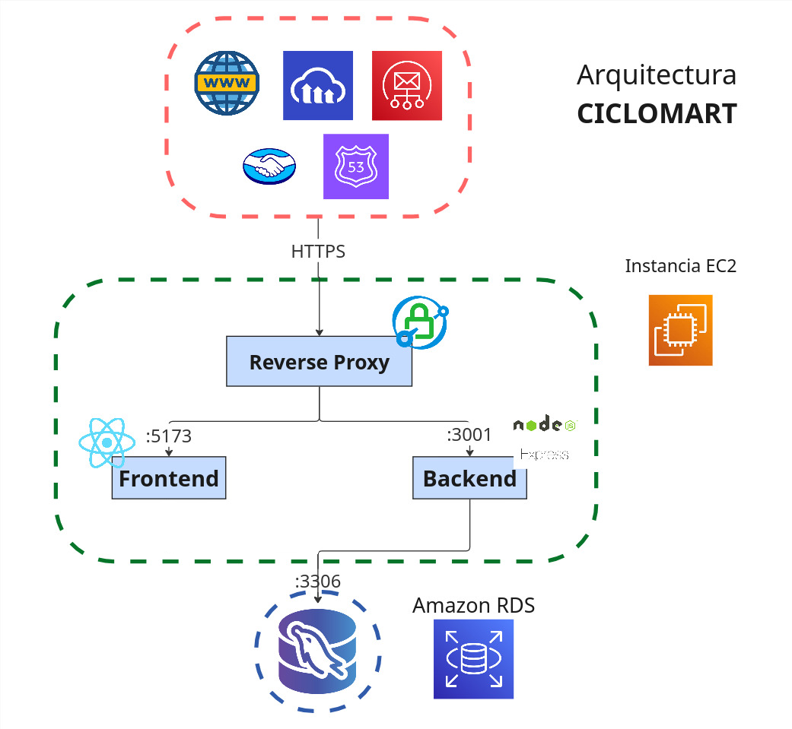

# CicloMart - Compra y venta de bicicletas y repuestos de ciclismo

[](README.md) [](README.es.md)

Monorepositorio de CicloMart, con la aplicación React/Vite y la API Express/MySQL.

- Link de la app: _antes desplegada en [ciclomart.com](https://ciclomart.com) — ahora fuera de línea; ver el video de demostración abajo_
- Instrucciones de usuario: _marcador de posición_
- Listado de horas: _marcador de posición_
- Guía del frontend: [frontend/README.es.md](frontend/README.es.md)
- Guía del backend: [backend/README.es.md](backend/README.es.md)

## Historia del repositorio

CicloMart se desarrolló originalmente como dos repositorios independientes:

- [`ciclomart_frontend`](https://github.com/your-username/ciclomart_frontend) — cliente React/Vite
- [`ciclomart_backend`](https://github.com/your-username/ciclomart_backend) — API Express/MySQL

El 9 de noviembre de 2026 ambos repositorios se unificaron en este monorepositorio para que los cambios del cliente y de la API se publiquen juntos. El historial completo de ambos proyectos se conserva bajo `frontend/` y `backend/`.

- La antigua URL del frontend ahora redirige a este repositorio.
- `ciclomart_backend` se mantiene como un espejo automático de solo lectura de [`backend/`](backend/). No hagas commits en el repositorio legado; los cambios se originan en este monorepositorio.
- El despliegue anterior en EC2 fue desmantelado. Los flujos de despliegue antiguos se conservan en `.github/workflows/*.yml.disabled` como referencia y no se ejecutan. La integración continua ahora solo ejecuta lint, build y pruebas.

## Descripción

CicloMart es una aplicación web de compra-venta de bicicletas y repuestos de ciclismo, con funcionalidades adaptadas a las necesidades de los ciclistas. Ofrece filtros avanzados de repuestos (grupos de transmisión, suspensión, peso, rines, frenos y muchas otras características), comparación de bicicletas y gestión segura de las tarjetas de propiedad legal de cada publicación, brindando una experiencia única, segura y confiable.

## Demo del proyecto


_Video de demostración de ejemplo._

### Página de inicio


### Página de registro


### Filtro avanzado de repuestos


### Vista de producto


### Perfil de usuario


## Arquitectura del sistema



## Estructura del repositorio

```
.
├─ frontend/          Aplicación React + Vite
├─ backend/           API REST Express + MySQL
├─ docs/              Capturas, diagramas y notas de despliegue compartidas
├─ .github/workflows/ CI y flujos de despliegue EC2 conservados (deshabilitados)
├─ package.json       Scripts raíz para ejecutar ambas aplicaciones
└─ README.md
```

## Primeros pasos

### Requisitos

- Node.js 22 y npm
- MySQL 8

### Instalación

```bash
git clone https://github.com/your-username/ciclomart.git
cd ciclomart
npm install
```

El script `postinstall` de la raíz instala las dependencias de `frontend/` y `backend/`. También puedes ejecutar `npm run install:all` para usar el lockfile de cada aplicación con `npm ci`.

### Variables de entorno

```bash
cp frontend/.env.example frontend/.env
cp backend/.env.example backend/.env
```

Completa ambos archivos. Consulta las guías del frontend y del backend para ver la lista completa de variables.

### Base de datos

Crea el esquema de MySQL con el script incluido:

```bash
mysql -u root -p < backend/database/dbCreation.sql
```

El backend toma los datos de conexión de `backend/.env` (`DB_HOST`, `DB_PORT`, `DB_USER`, `DB_PASSWORD`, `DB_NAME`).

### Ejecutar ambas aplicaciones

```bash
npm run dev
```

- Frontend: [http://localhost:5173](http://localhost:5173)
- API del backend: [http://localhost:3001](http://localhost:3001)

También puedes iniciarlas por separado con `npm run dev:web` y `npm run dev:api`.

### Scripts de la raíz

| Script                    | Descripción                                             |
| ------------------------- | ------------------------------------------------------- |
| `npm install`             | Instala dependencias de la raíz, frontend y backend     |
| `npm run install:all`     | Instalación reproducible con `npm ci` en ambas apps     |
| `npm run dev`             | Ejecuta frontend y backend juntos                       |
| `npm run dev:web`         | Ejecuta el servidor de desarrollo de Vite               |
| `npm run dev:api`         | Ejecuta la API Express con nodemon                      |
| `npm run build`           | Compila el frontend para producción                     |
| `npm run lint`            | Ejecuta el lint del frontend                            |
| `npm test`                | Ejecuta la suite de Jest del backend                    |
| `npm run check:translations` | Verifica las claves de traducción inglés/español    |
| `npm run format`          | Formatea el repositorio con Prettier                    |
| `npm run format:check`    | Verifica el formato sin escribir cambios                |

## Documentación

- Guía del frontend: [frontend/README.es.md](frontend/README.es.md)
- Guía del backend: [backend/README.es.md](backend/README.es.md)
- Encriptación: [backend/docs/ENCRYPTION.md](backend/docs/ENCRYPTION.md)
- Rotación de claves y AWS KMS: [backend/docs/KEY_ROTATION.md](backend/docs/KEY_ROTATION.md)

## Licencia

Este proyecto está distribuido bajo la Licencia MIT. Consulta el archivo [LICENSE](LICENSE) para obtener más información.

[](https://opensource.org/licenses/MIT)
