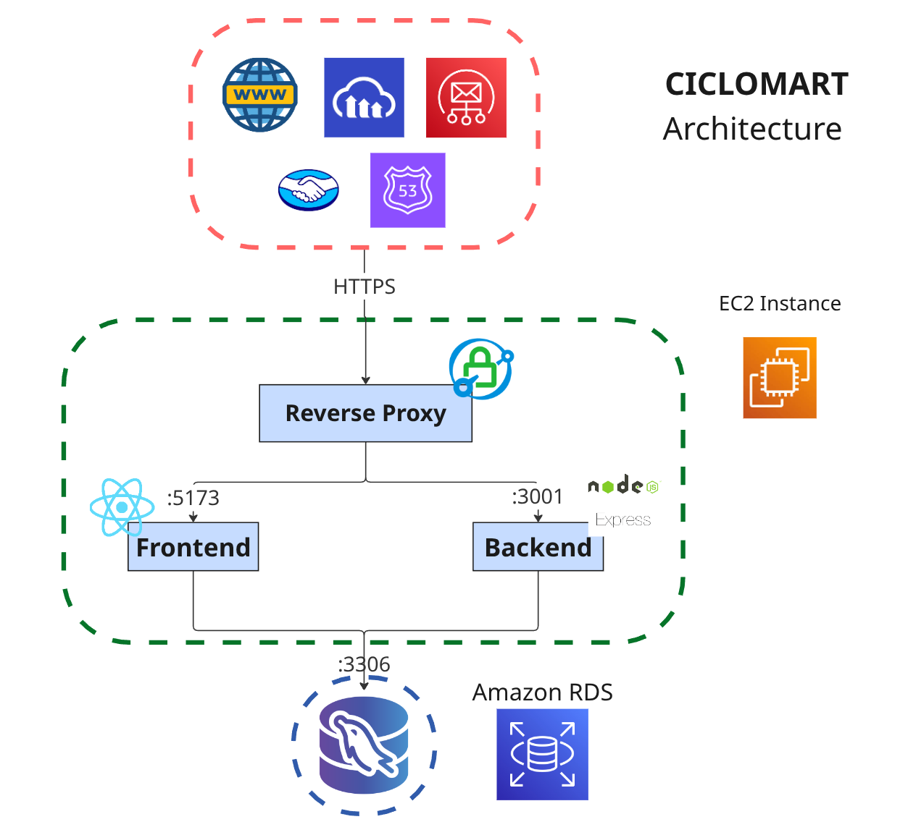

# CicloMart - Buy and Sell Bicycles and Cycling Spare Parts

[](README.md) [](README.es.md)

- App Link: _formerly deployed at [ciclomart.com](https://ciclomart.com) — now offline; see the demo video below_
- User Instructions: [Canva Presentation](https://www.canva.com/design/DAG23e0XYS4/qg8KUY0ukJcyz4XLgN-wlw/edit?utm_content=DAG23e0XYS4&utm_campaign=designshare&utm_medium=link2&utm_source=sharebutton)
- Hours Listing: [Google Spreadsheet](https://docs.google.com/spreadsheets/d/16X9bC5Drs2z4pwJ-D0CnR451mCKMRXd3i1B2WLkOS3M/edit?usp=sharing)

CicloMart was originally developed as two independent repositories:

- [`ciclomart_frontend`](https://github.com/w1sec0d/ciclomart_frontend) — React/Vite client
- [`ciclomart_backend`](https://github.com/w1sec0d/ciclomart_backend) — Express/MySQL API

On 9 November 2026 both repositories were unified into this monorepo so that client and API changes ship together. The full commit history of both projects is preserved under `frontend/` and `backend/`.

## Description

CicloMart is a web marketplace for buying and selling bicycles and cycling spare parts, with features tailored to the needs of cyclists. It offers advanced filters for spare parts (transmission groups, suspension, weight, rims, brakes, and many other characteristics), side-by-side bicycle comparison, and secure handling of legal ownership cards for every listing, providing a unique, secure, and reliable experience.

## Project Demo


[Click here to watch the full demo](https://youtu.be/vG_Zx618jJ4)

### Landing page


### Registration page


### Advanced spare parts filter


### Product view


### User profile


## System Architecture



## Repository structure

```
.
├─ frontend/          React + Vite single-page application
├─ backend/           Express + MySQL REST API
├─ docs/              Shared screenshots, diagrams and deployment notes
├─ .github/workflows/ CI and the retained (disabled) EC2 deployment workflows
├─ package.json       Root helper scripts for running both apps
└─ README.md
```

## Getting started

### Prerequisites

- Node.js 22 and npm
- MySQL 8

### Install

```bash
git clone https://github.com/w1sec0d/ciclomart.git
cd ciclomart
npm install
```

The root `postinstall` script installs the dependencies of both `frontend/` and `backend/`. You can also run `npm run install:all` to use each app's lockfile with `npm ci`.

### Environment variables

```bash
cp frontend/.env.example frontend/.env
cp backend/.env.example backend/.env
```

Fill in both files. See the frontend and backend guides for the full list of variables.

### Database

Create the MySQL schema from the bundled script:

```bash
mysql -u root -p < backend/database/dbCreation.sql
```

The backend reads the connection details from `backend/.env` (`DB_HOST`, `DB_PORT`, `DB_USER`, `DB_PASSWORD`, `DB_NAME`).

### Run both apps

```bash
npm run dev
```

- Frontend: [http://localhost:5173](http://localhost:5173)
- Backend API: [http://localhost:3001](http://localhost:3001)

You can also start them separately with `npm run dev:web` and `npm run dev:api`.

### Root scripts

| Script                    | Description                                      |
| ------------------------- | ------------------------------------------------ |
| `npm install`             | Installs root, frontend and backend dependencies |
| `npm run install:all`     | Reproducible install with `npm ci` in both apps  |
| `npm run dev`             | Runs frontend and backend together               |
| `npm run dev:web`         | Runs the Vite development server                 |
| `npm run dev:api`         | Runs the Express API with nodemon                |
| `npm run build`           | Builds the frontend for production               |
| `npm run lint`            | Lints the frontend                               |
| `npm test`                | Runs the backend Jest suite                      |
| `npm run check:translations` | Checks the English/Spanish translation keys   |
| `npm run format`          | Formats the repository with Prettier             |
| `npm run format:check`    | Verifies formatting without writing changes      |

## Documentation

- Frontend guide: [frontend/README.md](frontend/README.md)
- Backend guide: [backend/README.md](backend/README.md)
- Encryption: [backend/docs/ENCRYPTION.md](backend/docs/ENCRYPTION.md)
- Key rotation and AWS KMS: [backend/docs/KEY_ROTATION.md](backend/docs/KEY_ROTATION.md)

## Team Members

- **Juan David Madrid Contreras** - [JuMad-SE](https://github.com/JuMad-SE)
- **Carlos David Ramirez Muñoz** - [w1sec0d](https://github.com/w1sec0d)
- **Johan David Rodriguez Gutierrez** - [Homeroso](https://github.com/Homeroso)
- **Ronald Daniel Jacanamejoy Mutumbajoy** - [RonaldDaniel20](https://github.com/RonaldDaniel20)

## License

This project is licensed under the MIT License. See the [LICENSE](LICENSE) file for details.

[](https://opensource.org/licenses/MIT)
