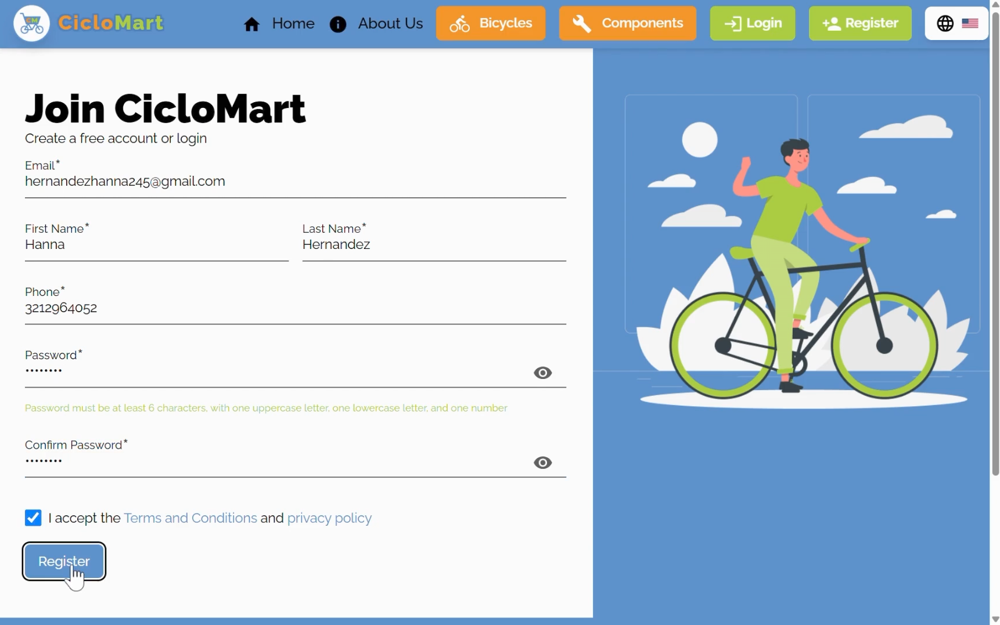
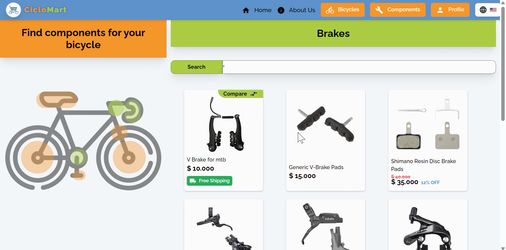
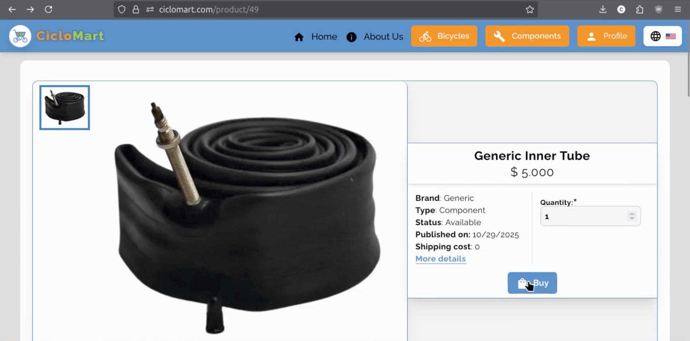
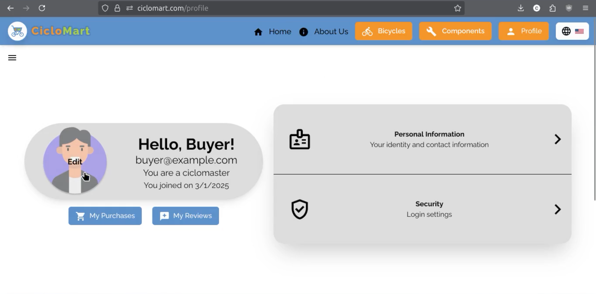
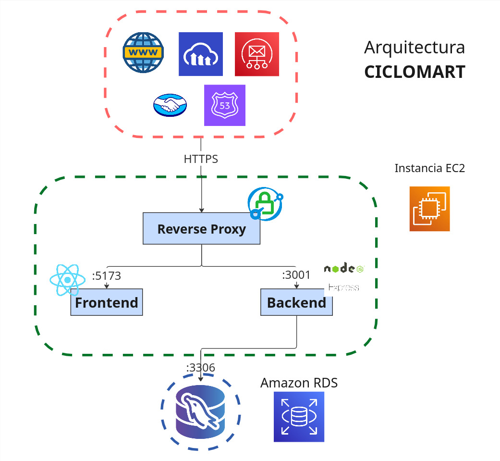

# CicloMart — Backend (Express + MySQL)

[](README.md) [](README.es.md)

Esta es la API REST de CicloMart, parte del [monorepositorio de CicloMart](../README.es.md).

- Link de la app: _antes desplegada en [ciclomart.com](https://ciclomart.com) — ahora fuera de línea; ver el video de demostración abajo_
- Instrucciones de usuario: [Presentación en Canva](https://www.canva.com/design/DAG23e0XYS4/qg8KUY0ukJcyz4XLgN-wlw/edit?utm_content=DAG23e0XYS4&utm_campaign=designshare&utm_medium=link2&utm_source=sharebutton)
- Listado de horas: [Hoja de cálculo en Google Sheets](https://docs.google.com/spreadsheets/d/16X9bC5Drs2z4pwJ-D0CnR451mCKMRXd3i1B2WLkOS3M/edit?usp=sharing)
- Guía del frontend: [frontend/README.es.md](../frontend/README.es.md)
- Raíz del monorepositorio: [README.es.md](../README.es.md)

> **Historia del repositorio:** esta API se desarrolló originalmente en el
> repositorio independiente [`ciclomart_backend`](https://github.com/w1sec0d/ciclomart_backend).
> Se unió con el frontend en el [monorepositorio de CicloMart](../README.es.md) el
> 9 de noviembre de 2026.
>
> `backend/` se sincroniza automáticamente con el repositorio legado `ciclomart_backend`
> mediante el flujo `Mirror backend to legacy repo`. Ese repositorio es de solo
> lectura: realiza los cambios aquí. El despliegue anterior en EC2 fue desmantelado;
> el flujo antiguo se conserva deshabilitado como referencia.

## Demo


[Haz clic aquí para ver la demo completa](https://youtu.be/vG_Zx618jJ4)

### Página de inicio


### Página de registro



### Filtro avanzado de repuestos



### Vista de producto



### Perfil de usuario



## Arquitectura del sistema



## Descripción

CicloMart es una aplicación web de compra-venta de bicicletas y repuestos de ciclismo, con funcionalidades adaptadas a las necesidades de los ciclistas. Ofrece filtros avanzados de repuestos (grupos de transmisión, suspensión, peso, rines, frenos y muchas otras características), comparación de bicicletas y gestión segura de las tarjetas de propiedad legal de cada publicación, brindando una experiencia única, segura y confiable.

## Miembros del equipo

- **Juan David Madrid Contreras** - [JuMad-SE](https://github.com/JuMad-SE)
- **Carlos David Ramirez Muñoz** - [w1sec0d](https://github.com/w1sec0d)
- **Johan David Rodriguez Gutierrez** - [Homeroso](https://github.com/Homeroso)
- **Ronald Daniel Jacanamejoy Mutumbajoy** - [RonaldDaniel20](https://github.com/RonaldDaniel20)

## Instalación para desarrolladores

El flujo recomendado es instalar y ejecutar todo desde la raíz del monorepositorio.

1. Clona el repositorio:

```bash
git clone https://github.com/w1sec0d/ciclomart.git
cd ciclomart
```

2. Instala las dependencias de ambas aplicaciones:

```bash
npm install
# o: npm run install:all
```

3. Copia y completa el archivo de entorno del backend:

```bash
cp backend/.env.example backend/.env
```

4. Crea el esquema de MySQL:

```bash
mysql -u root -p < backend/database/dbCreation.sql
```

5. Inicia la API (y el frontend si quieres la aplicación completa):

```bash
npm run dev:api
# o ambos: npm run dev
```

La API escucha en `http://localhost:3001` por defecto.

Para trabajar solo en el backend, ejecuta los comandos desde este directorio:

```bash
cd backend
npm install
npm run dev
```

### Variables de entorno

#### Variables de la base de datos

- DB_PORT: Puerto de la base de datos
- DB_HOST: Host de la base de datos
- DB_USER: Usuario de la base de datos
- DB_PASSWORD: Contraseña de la base de datos
- DB_NAME: Nombre de la base de datos

#### Variables del frontend

- FRONTEND_INTERNAL_URL: URL del frontend de la aplicación (desde red interna)
- FRONTEND_EXTERNAL_URL: URL del frontend de la aplicación (desde red externa)

#### Variables de autenticación

- JWT_SECRET: Clave secreta para el JSON Web Token

#### Variables de email (requeridas para enviar códigos de verificación)

- EMAIL_ONLINE: Correo electrónico para el envío de correo
- PASSWORD_ONLINE: Contraseña del correo electrónico para el envío de correo
- EMAIL_HOST: Host del correo electrónico
- EMAIL_PORT: Puerto del correo electrónico

#### Variables de MercadoPago (requeridas para configurar el gateway de pago)

- BACKEND_URL: URL del backend de la aplicación (debe ser accesible desde webhook de MercadoPago)
- MP_ACCESS_TOKEN: Token de acceso de MercadoPago (Payment Gateway)
- MP_CLIENT_ID: ID de cliente de MercadoPago (Payment Gateway)
- MP_CLIENT_SECRET: Secreto de cliente de MercadoPago (Payment Gateway)
- MP_PUBLIC_KEY: Clave pública de MercadoPago (Payment Gateway)
- MP_REDIRECT_URL: URL de redirección de MercadoPago (Payment Gateway)

#### Variables de encriptación (requeridas para encriptar datos sensibles)

**Básico (una clave):**

- AES_KEY: Clave de encriptación AES-256 (exactamente 32 caracteres). Genera con: `openssl rand -base64 24 | head -c 32`

**Avanzado (rotación de claves):**

- AES_KEY_V1, AES_KEY_V2, etc.: Claves versionadas para rotación
- AES_CURRENT_VERSION: Versión actual para nuevas encriptaciones (ej: "v2")

**AWS KMS (recomendado para producción):**

- KEY_PROVIDER: Establecer a "aws-kms" para usar AWS KMS
- AWS_REGION: Región de AWS (default: us-east-1)
- AWS_KMS_KEY_ID: ARN o alias de la clave KMS

Para más detalles, ver:

- [docs/ENCRYPTION.md](docs/ENCRYPTION.md) - Encriptación básica
- [docs/KEY_ROTATION.md](docs/KEY_ROTATION.md) - Rotación de claves y AWS KMS

Estos parámetros deben coincidir con una instancia de base de datos MySQL, puede ser inicializada con el script en `./database/dbCreation.sql`

## Licencia

Este proyecto está distribuido bajo la Licencia MIT. Consulta el archivo [LICENSE](../LICENSE) para obtener más información.

[](https://opensource.org/licenses/MIT)
