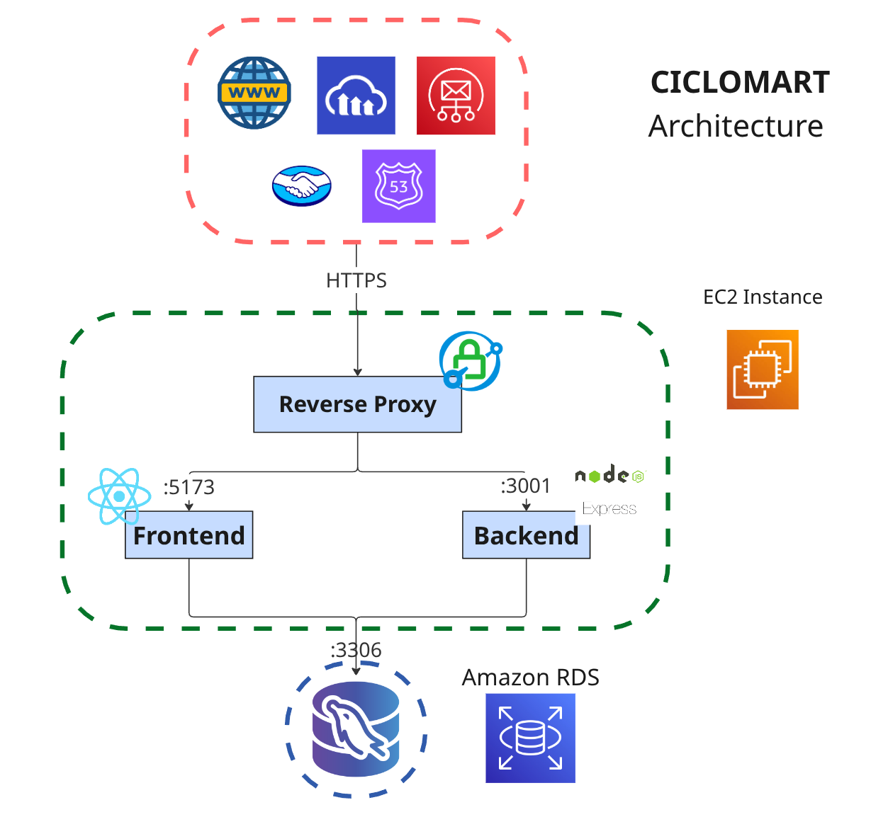

# CicloMart — Backend (Express + MySQL)

[](README.md) [](README.es.md)

This is the CicloMart REST API, part of the [CicloMart monorepo](../README.md).

- App Link: _formerly deployed at [ciclomart.com](https://ciclomart.com) — now offline; see the demo video below_
- User instructions: _placeholder_
- Hours listing: _placeholder_
- Frontend guide: [frontend/README.md](../frontend/README.md)
- Monorepo root: [README.md](../README.md)

> **Repository history:** this API was originally developed in the standalone
> [`ciclomart_backend`](https://github.com/your-username/ciclomart_backend) repository.
> It was merged with the frontend into the [CicloMart monorepo](../README.md) on
> 9 November 2026.
>
> `backend/` is automatically mirrored to the legacy `ciclomart_backend` repository
> by the `Mirror backend to legacy repo` workflow. Treat that repository as
> read-only and make changes here. The former EC2 deployment was decommissioned;
> the old deployment workflow is retained as a disabled file for reference.

## Description

CicloMart is a web marketplace for buying and selling bicycles and cycling spare parts, with features tailored to the needs of cyclists. It offers advanced filters for spare parts (transmission groups, suspension, weight, rims, brakes, and many other characteristics), side-by-side bicycle comparison, and secure handling of legal ownership cards for every listing, providing a unique, secure, and reliable experience.

## Demo


_Demo video placeholder._

### Landing page


### Registration page


### Advanced spare parts filter


### Product view


### User profile


## System Architecture



## Developer Installation

The recommended workflow is to install and run everything from the monorepo root.

1. Clone the repository:

```bash
git clone https://github.com/your-username/ciclomart.git
cd ciclomart
```

2. Install dependencies for both apps:

```bash
npm install
# or: npm run install:all
```

3. Copy and fill the backend environment file:

```bash
cp backend/.env.example backend/.env
```

4. Create the MySQL schema:

```bash
mysql -u root -p < backend/database/dbCreation.sql
```

5. Start the API (and the frontend if you want the full app):

```bash
npm run dev:api
# or both: npm run dev
```

The API listens on `http://localhost:3001` by default.

To work on the backend only, run the commands from this directory:

```bash
cd backend
npm install
npm run dev
```

### Environment variables

#### Database Variables

- DB_PORT: Database port
- DB_HOST: Database host
- DB_USER: Database user
- DB_PASSWORD: Database password
- DB_NAME: Database name

#### Frontend Variables

- FRONTEND_INTERNAL_URL: Frontend URL (internal address for communication between backend and frontend)
- FRONTEND_EXTERNAL_URL: Frontend URL (external address, must be publicly accessible. This sets up mercadopago callback URL)

#### Authentication Variables

- JWT_SECRET: JSON Web Token secret key

#### Email Variables (required to send verification codes)

- EMAIL_ONLINE: Email for email sending
- PASSWORD_ONLINE: Email password for email sending
- EMAIL_HOST: Email host
- EMAIL_PORT: Email port

#### MercadoPago Variables (required to set up payment gateway)

- BACKEND_URL: Backend URL (must be publicly accessible from mercadopago webhooks)
- MP_ACCESS_TOKEN: MercadoPago (Payment Gateway) access token
- MP_CLIENT_ID: MercadoPago (Payment Gateway) client id
- MP_CLIENT_SECRET: MercadoPago (Payment Gateway) client secret
- MP_PUBLIC_KEY: MercadoPago (Payment Gateway) public key
- MP_REDIRECT_URL: MercadoPago (Payment Gateway) redirect URL

#### Encryption Variables (required for sensitive data encryption)

**Basic (single key):**

- AES_KEY: AES-256 encryption key (exactly 32 characters). Generate with: `openssl rand -base64 24 | head -c 32`

**Advanced (key rotation):**

- AES_KEY_V1, AES_KEY_V2, etc.: Versioned keys for rotation
- AES_CURRENT_VERSION: Current version for new encryptions (e.g., "v2")

**AWS KMS (production recommended):**

- KEY_PROVIDER: Set to "aws-kms" to use AWS KMS
- AWS_REGION: AWS region (default: us-east-1)
- AWS_KMS_KEY_ID: KMS key ARN or alias

For more details, see:

- [docs/ENCRYPTION.md](docs/ENCRYPTION.md) - Encryption basics
- [docs/KEY_ROTATION.md](docs/KEY_ROTATION.md) - Key rotation and AWS KMS

These parameters must match a MySQL database instance, which can be initialized with the script in `./database/dbCreation.sql`

## License

This project is licensed under the MIT License. See the [LICENSE](../LICENSE) file for details.

[](https://opensource.org/licenses/MIT)
