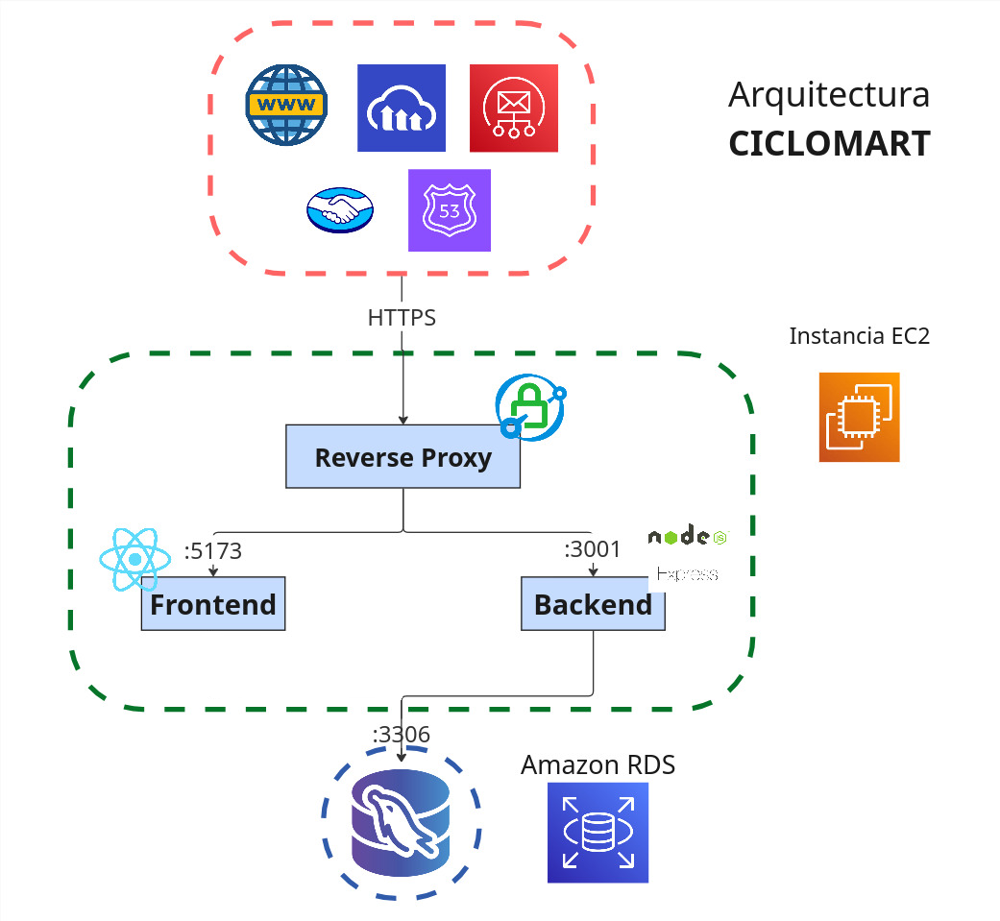

# CicloMart — Frontend (React + Vite)

[](README.md) [](README.es.md)

Esta es la aplicación de CicloMart, parte del [monorepositorio de CicloMart](../README.es.md).

- Link de la app: _antes desplegada en [ciclomart.com](https://ciclomart.com) — ahora fuera de línea; ver el video de demostración abajo_
- Instrucciones de usuario: _marcador de posición_
- Listado de horas: _marcador de posición_
- Guía del backend: [backend/README.es.md](../backend/README.es.md)
- Raíz del monorepositorio: [README.es.md](../README.es.md)

> **Historia del repositorio:** este cliente se desarrolló originalmente en el
> repositorio independiente [`ciclomart_frontend`](https://github.com/your-username/ciclomart_frontend).
> Se unió con el backend en el [monorepositorio de CicloMart](../README.es.md) el
> 9 de noviembre de 2026, y la antigua URL del repositorio ahora redirige aquí.

## Descripción

CicloMart es una aplicación web de compra-venta de bicicletas y repuestos de ciclismo, con funcionalidades adaptadas a las necesidades de los ciclistas. Ofrece filtros avanzados de repuestos (grupos de transmisión, suspensión, peso, rines, frenos y muchas otras características), comparación de bicicletas y gestión segura de las tarjetas de propiedad legal de cada publicación, brindando una experiencia única, segura y confiable.

## Demo del proyecto


_Video de demostración de ejemplo._

### Página de inicio


### Página de registro


### Filtro avanzado de repuestos


### Vista de producto


### Perfil de usuario


## Arquitectura del sistema



## Instalación para desarrolladores

El flujo recomendado es instalar y ejecutar todo desde la raíz del monorepositorio.

1. Clona el repositorio:

```bash
git clone https://github.com/your-username/ciclomart.git
cd ciclomart
```

2. Instala las dependencias de ambas aplicaciones:

```bash
npm install
# o: npm run install:all
```

3. Copia y completa el archivo de entorno del frontend:

```bash
cp frontend/.env.example frontend/.env
```

4. Inicia el frontend y el backend juntos:

```bash
npm run dev
```

5. Abre `http://localhost:5173` en tu navegador.

Para trabajar solo en el frontend usa `npm run dev:web`, o ejecuta los comandos de Vite desde este directorio:

```bash
cd frontend
npm install
npm run dev
```

### Variables de entorno

- `VITE_API_URL`: URL base de la API del backend de CicloMart, incluyendo el prefijo `/api` (p. ej. `http://localhost:3001/api`)
- `VITE_MP_PUBLIC_KEY`: clave pública de MercadoPago (segura de exponer en el navegador)
- `VITE_MP_CLIENT_ID`: ID de cliente de MercadoPago
- `VITE_MP_REDIRECT_URI`: URI de redirección OAuth de MercadoPago

### Consideraciones adicionales

- Es recomendable instalar la extensión del formateador [Prettier para VSCODE](https://marketplace.visualstudio.com/items?itemName=esbenp.prettier-vscode) y establecerla como formateador por defecto para archivos .js y .jsx

  > ❗ **Importante:** Antes de hacer un Pull Request es necesario ejecutar (desde la raíz del monorepositorio):

  ```bash
  npm run format
  ```

Esto formateará todos los archivos de forma estándar y evitará conflictos innecesarios en los pull request

- El proyecto usa Redux, una librería que permite tener un estado global en la aplicación,
  donde se almacenan los datos o las variables que se comparten entre los diferentes componentes.

  #### Usando el estado global
  - ¿Cómo se lee el estado global?
    Para acceder al estado global se debe usar el hook `useSelector` de la librería `react-redux`, este hook recibe una función que recibe el estado global y retorna solo una porción del estado que se necesite. Por ejemplo, así podremos acceder desde cualquier componente a la variable 'user' que contiene la información del usuario de forma global:

    ```javascript
    import { useSelector } from 'react-redux'
    // Más tarde en el componente que necesitemos:
    const Register = () => {
      const user = useSelector((state) => state.user)
      // ...
    }
    ```

  - ¿Cómo se modifica el estado global?
    Para modificar el estado primero usaremos el hook useDispatch, este retornará una función dispatch,
    que recibe como parámetro acciones definidas en los slices de Redux, estas acciones son funciones que
    modifican el estado global como setNotification(), clearNotification. Esto lo que nos permite es por ejemplo, desde cualquier componente, modificar la variable global de notificación

    ```javascript
    import { useDispatch } from 'react-redux'
    // Más tarde en el componente que necesitemos:
    const Register = () => {
      const dispatch = useDispatch()
      // ...
      dispatch(
        setNotification({
          title: 'Hola Redux!',
          text: 'Esto es una notificación',
          icon: 'info',
        })
      )
    }
    ```

  #### Depurando el estado global

  Para depurar el estado global se puede instalar la extensión de [Redux DevTools](https://chrome.google.com/webstore/detail/redux-devtools/lmhkpmbekcpmknklioeibfkpmmfibljd) en el navegador, esta extensión permite ver el estado global en tiempo real y ver las acciones que se están ejecutando.

  Esta extensión agrega una ventana en el navegador que muestra el estado global y las acciones que se están ejecutando, permitiendo ver el estado global en tiempo real y depurar la aplicación de forma más sencilla.

## Licencia

Este proyecto está distribuido bajo la Licencia MIT. Consulta el archivo [LICENSE](../LICENSE) para obtener más información.

[](https://opensource.org/licenses/MIT)
