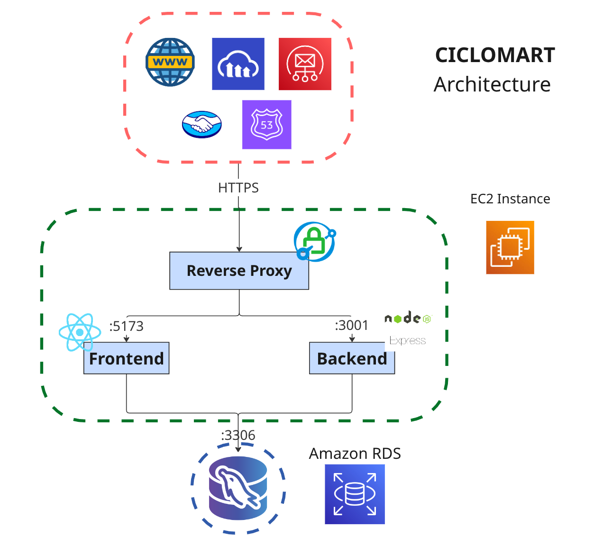

# CicloMart — Frontend (React + Vite)

[](README.md) [](README.es.md)

This is the CicloMart storefront, part of the [CicloMart monorepo](../README.md).

- App Link: _formerly deployed at [ciclomart.com](https://ciclomart.com) — now offline; see the demo video below_
- User Instructions: [Canva Presentation](https://www.canva.com/design/DAG23e0XYS4/qg8KUY0ukJcyz4XLgN-wlw/edit?utm_content=DAG23e0XYS4&utm_campaign=designshare&utm_medium=link2&utm_source=sharebutton)
- Hours Listing: [Google Spreadsheet](https://docs.google.com/spreadsheets/d/16X9bC5Drs2z4pwJ-D0CnR451mCKMRXd3i1B2WLkOS3M/edit?usp=sharing)
- Backend guide: [backend/README.md](../backend/README.md)
- Monorepo root: [README.md](../README.md)

> **Repository history:** this client was originally developed in the standalone
> [`ciclomart_frontend`](https://github.com/w1sec0d/ciclomart_frontend) repository.
> It was merged with the backend into the [CicloMart monorepo](../README.md) on
> 9 November 2026, and the old repository URL now redirects here.

## Description

CicloMart is a web marketplace for buying and selling bicycles and cycling spare parts, with features tailored to the needs of cyclists. It offers advanced filters for spare parts (transmission groups, suspension, weight, rims, brakes, and many other characteristics), side-by-side bicycle comparison, and secure handling of legal ownership cards for every listing, providing a unique, secure, and reliable experience.

## Project Demo


[Click here to watch the full demo](https://youtu.be/vG_Zx618jJ4)

### Landing page


### Registration page


### Advanced spare parts filter


### Product view


### User profile


## System Architecture



## Team Members

- **Juan David Madrid Contreras** - [JuMad-SE](https://github.com/JuMad-SE)
- **Carlos David Ramirez Muñoz** - [w1sec0d](https://github.com/w1sec0d)
- **Johan David Rodriguez Gutierrez** - [Homeroso](https://github.com/Homeroso)
- **Ronald Daniel Jacanamejoy Mutumbajoy** - [RonaldDaniel20](https://github.com/RonaldDaniel20)

## Developer Installation

The recommended workflow is to install and run everything from the monorepo root.

1. Clone the repository:

```bash
git clone https://github.com/w1sec0d/ciclomart.git
cd ciclomart
```

2. Install dependencies for both apps:

```bash
npm install
# or: npm run install:all
```

3. Copy and fill the frontend environment file:

```bash
cp frontend/.env.example frontend/.env
```

4. Start the frontend and backend together:

```bash
npm run dev
```

5. Open `http://localhost:5173` in your browser.

To work on the frontend only, use `npm run dev:web`, or run the Vite commands from this directory:

```bash
cd frontend
npm install
npm run dev
```

### Environment variables

- `VITE_API_URL`: base URL of the CicloMart backend API, including the `/api` prefix (e.g. `http://localhost:3001/api`)
- `VITE_MP_PUBLIC_KEY`: MercadoPago public key (safe to expose in the browser)
- `VITE_MP_CLIENT_ID`: MercadoPago client ID
- `VITE_MP_REDIRECT_URI`: MercadoPago OAuth redirect URI

### Additional Considerations

- It's recommended to install the [Prettier for VSCode](https://marketplace.visualstudio.com/items?itemName=esbenp.prettier-vscode) formatter extension and set it as the default formatter for .js and .jsx files

  > ❗ **Important:** Before making a Pull Request, you must run (from the monorepo root):

  ```bash
  npm run format
  ```

This will format all files in a standard way and avoid unnecessary conflicts in pull requests

- The project uses Redux, a library that allows having a global state in the application,
  where data or variables shared between different components are stored.

  #### Using Global State
  - How to read global state?
    To access global state, you must use the `useSelector` hook from the `react-redux` library. This hook receives a function that takes the global state and returns only a portion of the state that is needed. For example, this is how we can access the 'user' variable that contains user information globally from any component:

    ```javascript
    import { useSelector } from 'react-redux'
    // Later in the component we need:
    const Register = () => {
      const user = useSelector((state) => state.user)
      // ...
    }
    ```

  - How to modify global state?
    To modify the state, we first use the useDispatch hook, which will return a dispatch function
    that receives as a parameter actions defined in the Redux slices. These actions are functions that
    modify the global state like setNotification(), clearNotification. This allows us, for example, from any component, to modify the global notification variable

    ```javascript
    import { useDispatch } from 'react-redux'
    // Later in the component we need:
    const Register = () => {
      const dispatch = useDispatch()
      // ...
      dispatch(
        setNotification({
          title: 'Hello Redux!',
          text: 'This is a notification',
          icon: 'info',
        })
      )
    }
    ```

  #### Debugging Global State

  To debug global state, you can install the [Redux DevTools](https://chrome.google.com/webstore/detail/redux-devtools/lmhkpmbekcpmknklioeibfkpmmfibljd) browser extension. This extension allows you to see the global state in real time and view the actions being executed.

  This extension adds a window in the browser that shows the global state and the actions being executed, allowing you to see the global state in real time and debug the application more easily.

## License

This project is licensed under the MIT License. See the [LICENSE](../LICENSE) file for details.

[](https://opensource.org/licenses/MIT)
